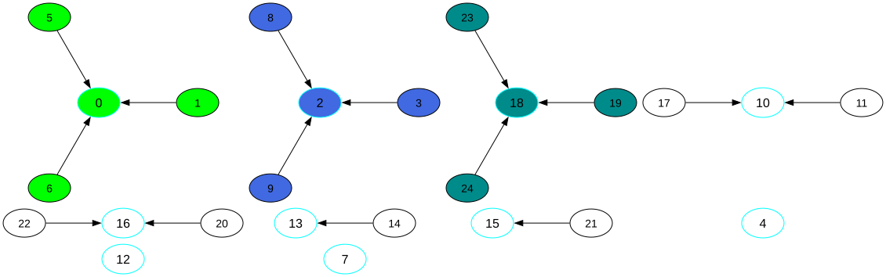

# Color Matrix Genalyzer (CMGA)

CMGA is a C++20 CLI tool that finds the max connected
region in one or more matrices. It supports depth-first search (DFS) and
Union-Find (UF), uses 8-neighbor connectivity, and can paint results, crop
regions, or visualize the UF structure. UF preserves every region tied for
largest size; DFS returns one largest region.

## Build

Requirements: CMake 4.4.5 or later, Ninja, and a C++20-compatible compiler.
The `default` configure preset uses Ninja Multi-Config, so one configuration
can be selected at build time:

```bash
cmake --preset default
cmake --build --preset Debug
# Or: Release, RelWithDebInfo, MinSizeRel
```

The executable is created at `build/bin/<Configuration>/cmga` (or `cmga.exe`
on Windows). In VS Code, use **Terminal > Run Build Task** to select a
configuration, or launch one of the matching CMGA debug configurations.

The helper script builds and copies the executable to `~/cmga_local` by
default. Pass a destination directory to change that location; `--clean`
removes the build directory before building.

```bash
./scripts/build_cmga.sh --build Debug
./scripts/build_cmga.sh --clean ~/cmga_prj
```

Use `./scripts/build_cmga.sh --help` for script options. Graphviz is optional
and required only for UF visualization.

## Usage

Run `cmga -h` for the complete CLI help. By default, CMGA processes matrix
files in `data/multicolor` and runs both algorithms.

```bash
# Analyze matrices in a directory
cmga --root data/multicolor --algo BOTH

# Analyze inline matrices and paint the largest region
cmga --mat "{{1, 2, 1}, {2, 3, 2}, {1, 2, 1}}" --paint

# Crop the largest region and visualize the UF structure
cmga --root data/multicolor --algo UF --crop --vis
```

### UF visualization example

The sample matrix in [examples/eq_size/mat_5_5_1_4.txt](examples/eq_size/mat_5_5_1_4.txt) has equally large connected regions (size 4) across three
color codes. UF visualizes those regions with distinct node colors:



### Main options

| Option                   | Description                                                                                                                   |
| ------------------------ | ----------------------------------------------------------------------------------------------------------------------------- |
| `--root <dir>`           | Input directory and output destination.                                                                                       |
| `--algo <DFS\|UF\|BOTH>` | Select the algorithm; default is `BOTH`.                                                                                      |
| `--mat <matrices>`       | Provide one or more C/C++-style matrices. Cell values must be integers from 1 to 9.                                           |
| `--paint`                | Paint the largest connected region.                                                                                           |
| `--no_color`             | Paint using black and white symbols.                                                                                          |
| `--crop`                 | Write largest region(s) and their original coordinates; UF writes each tied maximum region separately. Ignored when painting. |
| `--vis`                  | Visualize UF roots. Requires Graphviz; enabled when `max(rows, columns) <= 70`.                                               |
| `--force_vis`            | Visualize matrices above the default size limit. Use with caution.                                                            |
| `--conn_color <color>`   | Set the visualization connector color using an X11 color name or hex code.                                                    |
| `--help`, `-h`, `/?`     | Show help.                                                                                                                    |
| `--version`, `-v`        | Show version.                                                                                                                 |
| `--license`              | Show license information.                                                                                                     |

Without `--paint` or `--no_color`, results are written under the root directory.
The main operation overwrites existing output files.

## Matrix file generator

Generate random matrix files with `filegen`. Defaults are 10–20 rows and
columns in increments of 10, with values from 1 to 3. Dimensions can be at most
15,000; values are in the range 1–9.

```bash
# Generate rectangular matrices
cmga filegen --root data/generated --minr 10 --maxr 100 --r_inc 10 \
  --minc 10 --maxc 50 --c_inc 10 --csv

# Generate square matrices and overwrite existing files
cmga filegen --sq --minr 100 --maxr 500 --r_inc 100 --ovr
```

| Option                        | Description                                                         |
| ----------------------------- | ------------------------------------------------------------------- |
| `--root <dir>`                | Destination directory.                                              |
| `--sq`                        | Generate square matrices; do not use with column options.           |
| `--minr`, `--maxr`, `--r_inc` | Row range and increment.                                            |
| `--minc`, `--maxc`, `--c_inc` | Column range and increment.                                         |
| `--minv`, `--maxv`            | Minimum and maximum cell values; minimum must be less than maximum. |
| `--csv`                       | Write CSV files instead of space-separated text files.              |
| `--confirm`                   | Skip the interactive save confirmation.                             |
| `--ovr`                       | Allow overwriting existing files.                                   |

See [cmga_filetree.txt](cmga_filetree.txt) for the repository layout.

## License

CMGA is distributed under the [MIT License](LICENSE).
